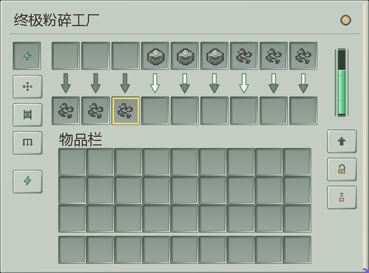

# Minecraft GUI 设计

首页选「GUI 设计」。容器界面默认从原版风格的「熔炉烧炼」开始，也可选「工作台合成」或空白面板。普通界面可用于配置页、手册或图鉴，提供手册示例与空白面板。保存 `.pixforge` 可保留布局、文案、主题贴图和动画。

## 机器容器的视觉风格

- 用 Minecraft 容器的比例和布局组织机器界面。以低饱和面板、内凹槽位和细倒角建立层次，同组控件用一致的圆角、描边和光向。用位置区分进料、出料、背包和快捷栏，将强调色用于工作状态、能量和告警。
- 参考现有模组时，先核对 Minecraft 和模组版本，从项目资源、对应发行包或源码取得同类机器的实际界面和 GUI 贴图。对照控件实现确认图标含义、绘制尺寸、位置与状态变化，再沿用目标项目的图形语义、布局习惯和状态反馈。
- 保留机器标题和物品栏标签，常用功能用轮廓易辨认的图标。功能名称、精确数值和状态说明可放进悬停提示。加工箭头沿物料流向填充。

## 绘图方法与贴图像素密度

### 选择 SVG 或逐像素绘制

- **结构清晰的形状优先用 SVG。** 由轮廓、直线、圆弧或简单色块构成的图形，用路径和基础形状来画，便于统一描边、圆角和状态变体。轴对齐的边沿逻辑网格放置，圆角、斜边和尖端保留透明抗锯齿。先保证最小显示尺寸下的轮廓和对比度，再补内部细节。
- **细节取决于像素排列时，用逐像素绘制。** 适用于需要手工控制色簇、颗粒、硬边或单像素标记的图形。已有位图沿用项目规定的原生尺寸和像素风格；新画位图按实际显示尺寸、可用切片及需要分辨的最小细节选尺寸。见 [小尺寸图标](../icons.md)。

### 选择尺寸

先定游戏内的逻辑布局。标准容器以 **18 × 18 逻辑像素**的物品槽为参照，具体布局和尺寸按目标项目的控件约定及界面内容确定。PixForge 的图集切片以 **64 × 32** 为参考坐标，物理画布尺寸独立设置。放大图集时，参考区域的坐标和宽高按同一倍数换算。例如 8 倍图集中，参考区域 `[18, 26, 6, 6]` 对应画布的 `[144, 208, 48, 48]`。

| 主题贴图 | 适用场景 |
|---|---|
| 64 × 32（1 倍） | 沿用原版硬边像素模板，或匹配已有的低分辨率主题。 |
| 128 × 64（2 倍） | 需要比原始图集更细的边缘或色簇，控件轮廓较简单。 |
| 256 × 128（4 倍） | SVG 与像素混合制图的常用起点，按最小控件的显示效果调整。 |
| 512 × 256（8 倍） | 切片较小、细描边和圆角较多，或目标界面需要较大显示缩放。 |

PixForge 4.14.3 起，GUI 预览保留高分辨率图集的实际像素。在「主题贴图」的「画布尺寸」选择对应档位，用目标 GUI 缩放查看最小图形，再决定最终密度。细节因采样不足而丢失时，可增加该切片的空间或提高整张图集的密度。

### 绘制、落图与预览

1. 先画一组有代表性的基础形状、最小图标和状态变化，在目标尺寸一起看过，再铺开整套。九宫格的圆角与倒角放在固定边片内，可拉伸区域使用平整色面或连续边缘。
2. 给 SVG 源里的控件和状态分组命名，按控件实际显示的宽高起稿。同一控件的动画帧共用轮廓、画布和锚点，填充类动画用裁切改变可见范围。
3. 用本地 SVG 渲染器（如 resvg）按目标贴图密度渲染成透明 RGBA。按 `gui_theme.sprites` 和组件的 `frame_regions` 确定切片，转为像素协议的 `patch` 送入 `canvas draw`，保留半透明边缘及相邻素材。工程中保留生成的贴图，用到 SVG 的控件同时保留可编辑源。游戏侧使用导出的 `theme.png`，按 `theme.reference_size` 与 `theme.image_size` 映射切片。
4. 按实际游戏显示大小看轮廓、倒角和图标，检查整张界面的层次。结合用到的状态查看悬停、禁用、待机、加工和完成，确认斜边、状态颜色和进度变化清楚。

## 搭建与预览

1. 用左栏添加面板、滚动区、文字、按钮、物品槽、进度条、页签或输入框。组件树可以折叠分支，按 Ctrl+F 搜索组件名称、ID 或类型，选中后用 F2 改显示名称。熔炉和工作台模板分为工作区与玩家背包，槽位组默认收起。用「+ 组」加入无底图的组件组，再调整子项顺序或移动组件。
2. 自由定位的组件可在画布拖动，按住 Shift 以 4 像素为步长。通过右栏设置位置、宽高、容器内边距、间距和列数，并为容器选择自由、纵向、横向或网格布局。默认物品槽为 18 × 18 逻辑像素。
3. 在「文案与翻译」设置翻译键、中文、英文和悬停提示，在「状态与动作」设置读取键、动作 ID、容器槽位索引或配方分类。面板可标记为配方查看器避让区域。
4. 切换视口和语言检查排版，用「交互预览」操作按钮、滚动区和输入框。Tab 切换焦点，Enter 触发动作。按钮有默认、悬停和禁用三态。
5. 在「主题贴图」设置画布尺寸并编辑图集。面板、凹槽、按钮、进度条和页签使用九宫格切片，槽位使用单张精灵图。按[绘图方法与贴图像素密度](#绘图方法与贴图像素密度)选择绘制方式和画布档位。

## 加工动画

- 熔炉模板有待机、烧炼和出炉阶段。点击「播放全程」查看火焰换帧、进度填充、产物出现和产物槽高亮。工作台模板包含 3×3 合成格、输出槽、物品栏和快捷栏，也可预览合成完成提示。
- 其他界面从顶部「加工动画」打开时间轴，再用「创建加工流程」生成待机、加工和完成阶段。阶段设置可改名称、时长、顺序及单段循环。选择阶段可单段播放，拖时间轴可停在指定时刻。
- 从组件树选对象，选择进度填充、图集帧、横纵位移、显示或高亮轨道，用「关键帧」在播放头添加或编辑数值。连续数值支持线性、缓动和保持。显隐和图集帧按关键帧切换。选「动画图标」后用「图集帧」指定 `[X,Y,宽,高]` 区域，再到「主题贴图」绘制帧像素。
- 设计器的播放用于预览。将布局中的阶段 ID、轨道和组件绑定交给模组适配器，由实际机器状态和进度驱动游戏界面。

## 命令与导出

- 使用 `project create`，`settings` 传 `{"preset":"gui","host":"container"}` 或 `{"preset":"gui","host":"screen"}`。容器可传 `starter: "crafting"` 创建工作台。可传 `blank: true` 从空白面板开始，也可用 `settings.gui` 提供完整组件树。
- 先用 `project gui-inspect` 读组件 ID、父子关系和阶段。传 `widget` 可只读一个组件，搭配 `clip` 可同时读该组件在指定阶段的轨道。
- 局部修改用 `project gui-edit`，提交有序的 `operations` 和观察到的工程 ID、版本。组件操作有 `add_widget`、`update_widget`、`move_widget` 和 `remove_widget`，动画操作有 `set_clip`、`set_track` 和 `set_keyframe`。同一批修改共用一次撤销。
- 完整布局由 `project state` 的 `gui_layout` 返回，可用 `project gui` 整体提交。主题图集按 `gui-inspect` 返回的 `theme.sprites` 或状态中的 `gui_theme.sprites` 读取区域，用 `canvas draw` 绘制。
- 用 `project gui-animation` 为没有动画的 GUI 建立阶段。用 `animation gui-sample` 读取指定阶段和毫秒处的数值。用 `workbench present` 传入 `panel:"gui"` 和 `gui_animation:{"clip":"working","time_ms":1200}` 截取精确的暂停帧。通过「导出 ZIP」或 `asset export-gui` 输出含动画的 `layout.json`、`theme.png` 和 `lang/*.json`。游戏项目读取这些资源，接入自己的 Screen/Menu、数据同步、物品槽行为和配方查看器。

例如，微调熔炉进度条的位置，并设置烧炼到 1200 ms 时的填充量。把 `gui-inspect` 返回的 `document_id` 和 `revision` 填入请求。

```json
{
  "group": "project",
  "command": "gui-edit",
  "params": {
    "expected_document_id": "<document_id>",
    "expected_revision": 12,
    "operations": [
      {"op":"update_widget","widget":"progress","fields":{"rect":[72,47,45,12]}},
      {"op":"set_keyframe","clip":"working","widget":"progress","property":"progress","time_ms":1200,"value":55}
    ]
  }
}
```

## 示例

终极粉碎工厂是一套九通道机器容器。下图截取自工程的加工阶段 2.08 秒。用 PixForge 4.14.3 或更新版本打开工程，可查看 512 × 256 主题贴图、组件树和加工动画。



[可编辑 PixForge 工程](../../assets/examples/gui-machine-container/machine-container.pixforge) · [对应的 GUI 资源导出包](../../assets/examples/gui-machine-container/gui-resources.zip)
